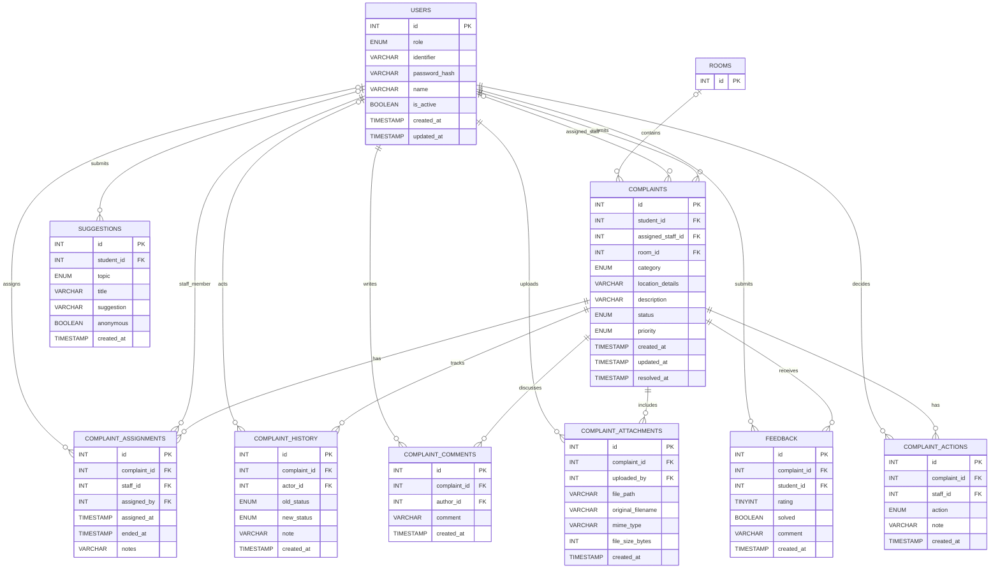

# ZeroDayZ
This is the source code for the *Centralized Hostel Complaint Management and Maintenance System*.

## Database Schema

The following Mermaid ER diagram documents the supplied MySQL schema. `rooms` is
included as a referenced dependency because `complaints.room_id` has a foreign
key to it, although its `CREATE TABLE` definition was not included in the
schema block.

### Relationship Notes

- A user can submit many complaints, feedback records, comments, attachments, and suggestions.
- A complaint can be assigned to staff, tracked through status history, discussed, attached to files, and acted on by staff.
- Each feedback record belongs to one complaint and one student. The schema permits one feedback record per complaint/student pair.
- Suggestions may be anonymous. Anonymous suggestions store `student_id` as `NULL` and set `anonymous` to `TRUE`.
- Deleting referenced users, complaints, or rooms is restricted unless the foreign key explicitly uses `ON DELETE SET NULL`.

## 🔀 Branch Structure:

* **main** -> Contains production ready code.

* **develop** -> This is the integration branch for all other branches.

* **feature/X** -> In this branch a feature X may be bulit.

* **fix/X3** -> In this a bug X3 may be fixed.

----

### 📝 LICENSE:

Check [LICENSE.md](./LICENSE) for more details.

----

 Made with 🩵 
